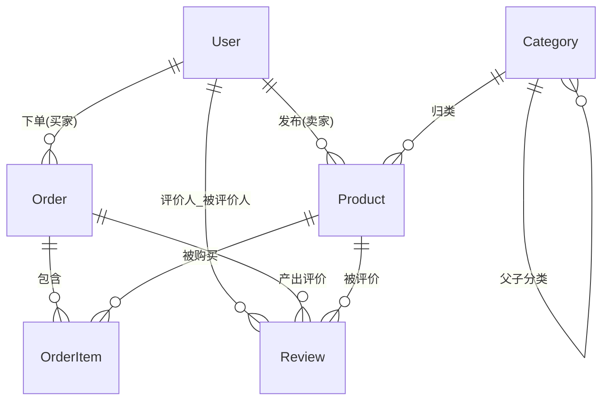

# 智能二手交易平台 · 数据库 & API 契约

> 版本 `v1` ｜ 数据库 **MySQL 8.0+** ｜ API 前缀 `/api/v1` ｜ Schema 位置 [`server/prisma/schema.prisma`](../prisma/schema.prisma)

---

## 一、选型说明（必读）

数据库采用 **MySQL 8.0+**。

Prisma 的标量列表（`String[]`）**在 MySQL 上不被支持**，已用 Prisma 6.19.3 实测：

```text
error: Field "images" in model "Product" can't be a list.
       The current connector does not support lists of primitive types.
```

因此商品图片与评价晒图改用 **`Json`** 存字符串数组：`Product.images Json`、`Review.images Json`。
写入时直接传 JS 数组，读出即为数组 —— **API 契约与前端 `string[]` 类型均无需改动**。

> 若改用 PostgreSQL，可把这两处 `Json` 换回 `String[]`（原生数组），其余模型无需改动。

---

## 二、E-R 说明

### 2.1 实体关系图



### 2.2 关系与基数

| 关系 | 基数 | 外键 | 说明 |
| --- | --- | --- | --- |
| User → Product | 1 : N | `products.sellerId` | 卖家发布商品 |
| Category → Product | 1 : N | `products.categoryId` | 分类归类 |
| Category → Category | 1 : N | `categories.parentId` | 自关联，二级分类；删除父类置 `NULL` |
| User → Order | 1 : N | `orders.buyerId` | 买家下单 |
| Order → OrderItem | 1 : N | `order_items.orderId` | 级联删除 |
| Product → OrderItem | 1 : N | `order_items.productId` | 订单↔商品的多对多拆解 |
| Order → Review | 1 : N | `reviews.orderId` | 一单可评价多个商品；级联删除 |
| Product → Review | 1 : N | `reviews.productId` | 商品维度聚合评分 |
| User → Review | 1 : N | `reviews.reviewerId` / `reviews.revieweeId` | 评价人（买家）/ 被评价人（卖家） |

### 2.3 建模要点

1. **订单与商品不直接相连**，统一通过 `OrderItem` 关联，并在 `OrderItem` 中保存
   `title / image / price` 快照 —— 商品后续改价、下架都不影响历史订单。
2. **卖家不在 `Order` 上冗余**，通过 `OrderItem → Product.sellerId` 推导，
   避免一个订单出现多个卖家时数据不一致。
3. **金额全部 `Decimal(10, 2)`**，禁止 `Float`（浮点误差会导致对账不平）。
4. **主键统一 `cuid()`**，非自增、不可枚举，避免爬虫按 id 遍历。
5. 所有表都具备 `id / createdAt / updatedAt / status / 外键`。

---

## 三、订单状态机

```text
                      ┌──────────────────┐
   创建订单 ─────────▶ │  PENDING_PAYMENT │ 待付款
                      └────────┬─────────┘
                       支付成功 │        │ 取消 / 超时
                               ▼        ▼
                      ┌──────────────────┐   ┌───────────┐
                      │ PENDING_SHIPMENT │   │ CANCELLED │ 已取消
                      └────────┬─────────┘   └───────────┘
                    卖家发货    │        │ 取消
                               ▼        └───────┘
                          ┌──────────┐
                          │ SHIPPED  │ 已发货
                          └────┬─────┘
                   买家确认收货 │
                               ▼
                          ┌───────────┐
                          │ COMPLETED │ 已完成
                          └─────┬─────┘
                    买家提交评价 │
                               ▼
                          ┌──────────┐
                          │ REVIEWED │ 已评价
                          └──────────┘
```

| 状态 | 枚举值 | 中文 | 允许的下一步 |
| --- | --- | --- | --- |
| 1 | `PENDING_PAYMENT` | 待付款 | 支付 / 取消 |
| 2 | `PENDING_SHIPMENT` | 待发货 | 发货 / 取消 |
| 3 | `SHIPPED` | 已发货 | 确认收货 |
| 4 | `COMPLETED` | 已完成 | 评价 |
| 5 | `REVIEWED` | 已评价 | 终态 |
| — | `CANCELLED` | 已取消 | 终态（兜底，非需求 5 态） |

> 每个状态流转都会写入对应时间戳（`paidAt / shippedAt / completedAt / reviewedAt / cancelledAt`），
> 用于数据看板计算履约时长与 GMV 趋势。
> **状态流转必须在后端 Service 层校验前置状态**，禁止前端传状态直接落库。

---

## 四、RESTful API 契约

### 4.0 全局约定

**统一响应体**

```jsonc
{
  "code": 0,          // 0 = 成功，非 0 = 业务错误
  "message": "ok",
  "data": {}          // 失败时为 null
}
```

**HTTP 状态码与业务码对照**

| HTTP | code | 含义 |
| --- | --- | --- |
| 200 | `0` | 成功 |
| 400 | `40001` | 参数校验失败（zod） |
| 401 | `40100` | 未登录 / token 无效或过期 |
| 403 | `40300` | 无权限（角色不符或非资源所有者） |
| 404 | `40400` | 资源不存在 |
| 409 | `40900` | 状态冲突（如重复支付、库存不足） |
| 429 | `42900` | 请求过于频繁 |
| 500 | `50000` | 服务器内部错误 |

**鉴权**：`Authorization: Bearer <JWT>`；角色 `USER` / `SELLER` / `ADMIN`。

**分页信封**（列表接口的 `data` 统一为）：

```jsonc
{ "list": [], "total": 128, "page": 1, "pageSize": 20 }
```

**金额字段的序列化约定（已实测确认）**

Prisma 的 `Decimal` 在 JSON 序列化时会**归一化掉尾随零**，直接返回会得到 `"1899"` 而不是 `"1899.00"`：

```js
price.toString()        // "1899"      ← 尾随零丢失，仅是显示问题
price.toFixed(2)        // "1899.00"   ← 正确写法
JSON.stringify(price)   // "1899"
```

精度本身安全（实测写入 `"1899.55"` 可精确往返，聚合求和也无浮点误差），
但**所有出参中的金额字段必须在序列化前调用 `.toFixed(2)`**，
否则前端拿到的 `1899` 与本契约示例不符，金额展示不统一。

---

### 4.1 用户 / 认证 · `/api/v1/auth`

| 方法 | 路径 | 鉴权 | 请求参数 | 响应 `data` |
| --- | --- | --- | --- | --- |
| POST | `/auth/register` | 公开 | `username` `email` `password` `role?`(`USER`\|`SELLER`) | `{ token, user }` |
| POST | `/auth/login` | 公开 | `account`(用户名/邮箱) `password` | `{ token, user }` |
| GET | `/auth/me` | 登录 | — | `user` |
| PUT | `/auth/profile` | 登录 | `nickname?` `avatar?` `phone?`（`null` 表示清空） | `user` |
| PUT | `/auth/password` | 登录 | `oldPassword` `newPassword` | `null` |

> `user` 出参**永远不含 `passwordHash`**（Prisma `select` 白名单）。
> 密码用 `bcryptjs` 加盐哈希，`JWT_SECRET` 只存在于后端 `.env`。
> 修改密码成功后需**重新登录**（前端清除本地 token 并跳转登录页）。

### 4.2 分类 · `/api/v1/categories`

| 方法 | 路径 | 鉴权 | 请求参数 | 响应 `data` |
| --- | --- | --- | --- | --- |
| GET | `/categories` | 公开 | `parentId?` `status?` | `Category[]`（树形） |
| GET | `/categories/:id` | 公开 | — | `Category` |
| POST | `/categories` | ADMIN | `name` `slug` `parentId?` `sortOrder?` `icon?` | `Category` |
| PATCH | `/categories/:id` | ADMIN | 同上（部分更新） | `Category` |
| DELETE | `/categories/:id` | ADMIN | — | `null` |

### 4.3 商品 · `/api/v1/products`

| 方法 | 路径 | 鉴权 | 请求参数 | 响应 `data` |
| --- | --- | --- | --- | --- |
| GET | `/products` | 公开 | `keyword?` `categoryId?` `minPrice?` `maxPrice?` `condition?` `sort?`(`latest`\|`price_asc`\|`price_desc`\|`hot`) `page?` `pageSize?` | 分页信封，`list` 为 `Product` |
| GET | `/products/:id` | 公开 | — | `ProductDetail`（含 `seller`、`category`、`avgRating`、`reviewCount`） |
| GET | `/products/mine` | SELLER | `status?` `page?` `pageSize?` | 分页信封 |
| POST | `/products` | SELLER | `title` `description?` `price` `originalPrice?` `images[]` `condition` `categoryId` `stock?` | `Product`（`status=PENDING_REVIEW`） |
| PATCH | `/products/:id` | SELLER(本人) / ADMIN | 可编辑字段 | `Product` |
| PATCH | `/products/:id/on-sale` | SELLER(本人) | — | `Product`（`OFF_SHELF`→`ON_SALE`） |
| DELETE | `/products/:id` | SELLER(本人) / ADMIN | — | `null`（软删：置 `OFF_SHELF`） |

> `price` / `originalPrice` 必须是**数字或数字字符串**，后端用 zod + Prisma `Decimal` 接收，
> 禁止经 `Number` 二次转换后写库。

### 4.4 交易 · `/api/v1/orders`

| 方法 | 路径 | 鉴权 | 请求参数 | 响应 `data` |
| --- | --- | --- | --- | --- |
| POST | `/orders` | 登录 | `items[]{ productId, quantity }` `receiverName` `receiverPhone` `receiverAddress` `remark?` | `Order`（`PENDING_PAYMENT`） |
| GET | `/orders` | 登录 | `role?`(`buyer`\|`seller`) `status?` `page?` `pageSize?` | 分页信封 |
| GET | `/orders/:id` | 参与方 / ADMIN | — | `OrderDetail`（含 `items` 快照） |
| POST | `/orders/:id/pay` | 买家 | `payMethod?` | `Order`（→ `PENDING_SHIPMENT`） |
| POST | `/orders/:id/ship` | 卖家 | `expressCompany?` `trackingNo?` | `Order`（→ `SHIPPED`） |
| POST | `/orders/:id/confirm` | 买家 | — | `Order`（→ `COMPLETED`） |
| POST | `/orders/:id/cancel` | 买家 | `reason?` | `Order`（→ `CANCELLED`） |
| POST | `/orders/:id/reviews` | 买家 | `items[]{ productId, rating(1-5), content?, images? }` | `Review[]`（订单 → `REVIEWED`） |

> **下单事务**：校验商品 `status=ON_SALE` 且库存充足 → 创建 `Order` + `OrderItem[]`
> （写入快照并计算 `subtotal`）→ 汇总 `totalAmount` → 商品置 `SOLD`。
> 全流程放在 `prisma.$transaction()` 内，避免超卖。

### 4.5 AI 搜索 · `/api/v1/ai`

| 方法 | 路径 | 鉴权 | 请求参数 | 响应 `data` |
| --- | --- | --- | --- | --- |
| POST | `/ai/search` | 公开（建议登录） | `{ query: string, page?, pageSize? }` | `{ filters, list, total, page, pageSize }` |
| POST | `/ai/parse` | 登录 | `{ query: string }` | `{ filters }`（仅调试用，不查库） |

**请求 / 响应示例**

```jsonc
// 请求
{ "query": "1000 元以内的九成新 iPhone，最好在广州", "page": 1, "pageSize": 20 }

// 响应
{
  "code": 0,
  "message": "ok",
  "data": {
    "filters": {                       // DeepSeek 自然语言 → 结构化条件
      "keyword": "iPhone",
      "maxPrice": "1000.00",
      "condition": ["LIKE_NEW", "GOOD"],
      "city": "广州"
    },
    "list": [],
    "total": 6,
    "page": 1,
    "pageSize": 20
  }
}
```

> `DEEPSEEK_API_KEY` **只能在后端 `.env` 中使用**，前端只调用 `/ai/search`，
> 绝不接触 Key，也绝不直连 DeepSeek。解析出的 `filters` 必须经 zod 白名单校验后
> 再交给 Prisma 查询，禁止把模型输出直接拼进查询。

### 4.6 数据看板 · `/api/v1/dashboard`

| 方法 | 路径 | 鉴权 | 请求参数 | 响应 `data` |
| --- | --- | --- | --- | --- |
| GET | `/dashboard/seller` | SELLER | `days?`(默认 30) | `{ onSaleCount, soldCount, gmv, pendingShipCount, avgRating }` |
| GET | `/dashboard/seller/trend` | SELLER | `days?` | `{ dates[], gmv[], orderCount[] }`（ECharts 折线） |
| GET | `/dashboard/admin` | ADMIN | `days?` | `{ userCount, productCount, orderCount, gmv, pendingAuditCount }` |
| GET | `/dashboard/admin/trend` | ADMIN | `days?` `metric?` | `{ dates[], values[] }` |
| GET | `/dashboard/admin/category-distribution` | ADMIN | — | `{ categories[], counts[] }`（ECharts 饼图） |

### 4.7 管理员 · `/api/v1/admin`

| 方法 | 路径 | 鉴权 | 请求参数 | 响应 `data` |
| --- | --- | --- | --- | --- |
| GET | `/admin/users` | ADMIN | `keyword?` `role?` `status?` `page?` | 分页信封 |
| PATCH | `/admin/users/:id/status` | ADMIN | `{ status: "ACTIVE" \| "BANNED" }` | `user` |
| GET | `/admin/products` | ADMIN | `status?` `page?` | 分页信封（审核队列） |
| PATCH | `/admin/products/:id/audit` | ADMIN | `{ approve: boolean, rejectReason? }` | `Product`（→ `ON_SALE` / `REJECTED`） |
| GET | `/admin/orders` | ADMIN | `status?` `page?` | 分页信封 |
| PATCH | `/admin/reviews/:id/status` | ADMIN | `{ status: "VISIBLE" \| "HIDDEN" }` | `Review` |

---

## 五、索引建议

`schema.prisma` 中已声明 **29 个索引**（含唯一索引），加上 6 个主键隐式索引，落库后共 **35 个索引**。设计依据：

| 表 | 索引 | 服务的查询 |
| --- | --- | --- |
| `users` | `username` `email` `phone`(唯一) | 登录、唯一性校验 |
| `users` | `(role)` `(status)` `(createdAt)` | 管理员筛选、用户增长趋势 |
| `categories` | `name` `slug`(唯一) | 路由 / SEO |
| `categories` | `(parentId)` `(status, sortOrder)` | 子分类、前台分类树 |
| `products` | `(sellerId)` `(categoryId)` | 卖家商品列表、分类筛选 |
| `products` | `(status, createdAt)` | 首页在售商品倒序（覆盖索引，免排序） |
| `products` | `(status, price)` `(status, viewCount)` | 价格区间 / 排序、热门榜 |
| `orders` | `orderNo`(唯一) | 对外订单号查询 |
| `orders` | `(buyerId, status)` | 「我的订单」按状态筛选 |
| `orders` | `(status, createdAt)` `(createdAt)` | 待处理订单、GMV 按日聚合 |
| `order_items` | `(orderId, productId)`(唯一) | 防重复下单同一商品 |
| `order_items` | `(orderId)` `(productId)` `(status)` | 订单详情、销量统计、分行履约 |
| `reviews` | `(orderId, productId, reviewerId)`(唯一) | 同一订单同一商品只能评价一次 |
| `reviews` | `(productId, status)` `(revieweeId, status)` | 商品评价列表、卖家信誉分 |

**额外建议（Prisma schema 无法表达，需手写迁移）**：

AI 搜索的关键词模糊匹配请不要用 `LIKE '%x%'`（无法走索引）。商品量上万后执行：

```sql
-- MySQL 全文索引：ngram 分词器专门用于中文（MySQL 5.7.6+ 内置）
ALTER TABLE products
  ADD FULLTEXT INDEX products_title_desc_ft (title, description) WITH PARSER ngram;
```

查询改写为 `MATCH(title, description) AGAINST ('iPhone' IN BOOLEAN MODE)`。
注意 MySQL 全文索引的 `ngram_token_size` 默认是 2，即**不会匹配单字关键词**；
中文场景通常够用，若需单字检索须在建库时调小该参数（需重建索引）。

放置位置：`server/prisma/migrations/<时间戳>_add_search_index/migration.sql`（迁移创建后手工追加以保持可追溯）。

---

## 六、curl 示例

> 以下为 bash / Git Bash 语法。Windows PowerShell 中请把 `curl` 写成 `curl.exe`，
> 或使用 `Invoke-RestMethod`，否则 `curl` 是 `Invoke-WebRequest` 的别名、`\` 续行会报错。

### 示例 1 · 注册并获取 JWT

```bash
curl -X POST "http://localhost:3000/api/v1/auth/register" \
  -H "Content-Type: application/json" \
  -d '{
    "username": "seller_li",
    "email": "seller_li@example.com",
    "password": "Passw0rd!2026",
    "role": "SELLER"
  }'
```

```jsonc
// 响应
{
  "code": 0,
  "message": "注册成功",
  "data": {
    "token": "eyJhbGciOiJIUzI1NiIsInR5cCI6IkpXVCJ9...",
    "user": {
      "id": "clz8k1x2b0000abcd1234efgh",
      "username": "seller_li",
      "email": "seller_li@example.com",
      "nickname": null,
      "avatar": null,
      "role": "SELLER",
      "status": "ACTIVE",
      "createdAt": "2026-10-07T09:27:32.414Z"
    }
  }
}
```

### 示例 2 · 卖家发布商品（进入待审核）

```bash
TOKEN="eyJhbGciOiJIUzI1NiIsInR5cCI6IkpXVCJ9..."

curl -X POST "http://localhost:3000/api/v1/products" \
  -H "Content-Type: application/json" \
  -H "Authorization: Bearer $TOKEN" \
  -d '{
    "title": "iPhone 13 128G 蓝色 九成新",
    "description": "自用无拆修，电池健康 92%，配件齐全",
    "price": "1899.00",
    "originalPrice": "5999.00",
    "images": [
      "https://cdn.example.com/p/iphone13-1.jpg",
      "https://cdn.example.com/p/iphone13-2.jpg"
    ],
    "condition": "LIKE_NEW",
    "categoryId": "clz8k2c4d0001efgh5678ijkl",
    "stock": 1
  }'
```

```jsonc
// 响应
{
  "code": 0,
  "message": "发布成功，等待管理员审核",
  "data": {
    "id": "clz8k9m0n0002opqr9012stuv",
    "title": "iPhone 13 128G 蓝色 九成新",
    "price": "1899.00",          // Decimal 序列化为字符串，避免精度丢失
    "images": ["https://cdn.example.com/p/iphone13-1.jpg", "https://cdn.example.com/p/iphone13-2.jpg"],
    "status": "PENDING_REVIEW",
    "stock": 1,
    "sellerId": "clz8k1x2b0000abcd1234efgh",
    "categoryId": "clz8k2c4d0001efgh5678ijkl",
    "createdAt": "2026-10-07T09:31:05.120Z"
  }
}
```

### 示例 3 · 买家下单（创建待付款订单）

```bash
BUYER_TOKEN="eyJhbGciOiJIUzI1NiIsInR5cCI6IkpXVCJ9..."

curl -X POST "http://localhost:3000/api/v1/orders" \
  -H "Content-Type: application/json" \
  -H "Authorization: Bearer $BUYER_TOKEN" \
  -d '{
    "items": [{ "productId": "clz8k9m0n0002opqr9012stuv", "quantity": 1 }],
    "receiverName": "李四",
    "receiverPhone": "13800138000",
    "receiverAddress": "广东省广州市天河区体育西路 1 号",
    "remark": "工作日送货"
  }'
```

```jsonc
// 响应
{
  "code": 0,
  "message": "下单成功",
  "data": {
    "id": "clz8ka1b20003wxyz3456abcd",
    "orderNo": "20261007093105001",
    "buyerId": "clz8k7f8g0009qrst1234mnop",
    "totalAmount": "1899.00",
    "status": "PENDING_PAYMENT",
    "receiverName": "李四",
    "receiverPhone": "13800138000",
    "receiverAddress": "广东省广州市天河区体育西路 1 号",
    "paidAt": null,
    "shippedAt": null,
    "completedAt": null,
    "reviewedAt": null,
    "cancelledAt": null,
    "items": [
      {
        "id": "clz8ka1b20004efgh7890ijkl",
        "productId": "clz8k9m0n0002opqr9012stuv",
        "title": "iPhone 13 128G 蓝色 九成新",   // 下单快照
        "image": "https://cdn.example.com/p/iphone13-1.jpg",
        "price": "1899.00",
        "quantity": 1,
        "subtotal": "1899.00",
        "status": "PENDING"
      }
    ],
    "createdAt": "2026-10-07T09:31:05.120Z"
  }
}
```

---

## 七、迁移与回退

```bash
# 1) 进入后端目录并安装依赖（Prisma 固定 6.x，latest 目前指向 8.0.0-rc 不建议）
cd server
npm i @prisma/client@^6
npm i -D prisma@^6 typescript tsx nodemon @types/node

# 2) 配置 .env（复制根目录 .env.example，填入本机 MySQL 密码）
#    DATABASE_URL="mysql://root:密码@localhost:3306/smart_second_hand"

# 3) 生成 client + 执行首次迁移
npx prisma generate
npx prisma migrate dev --name init
# 4) 灌入演示数据（幂等，可重复执行）
npm run seed

# 5) 可视化查看数据
npx prisma studio
```

**回退方案**

```bash
# 回退最近一次迁移（生产慎用，会丢数据）
npx prisma migrate resolve --rolled-back <migration_name>

# 开发环境整体重置
npx prisma migrate reset --force

# 彻底回退本次交付：删除目录 + 还原 .env.example
rm -rf server/prisma server/docs
git checkout -- .env.example
```
